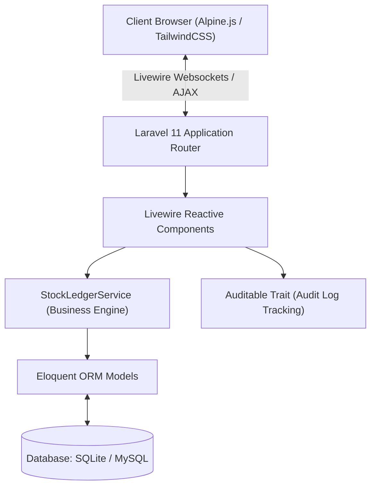
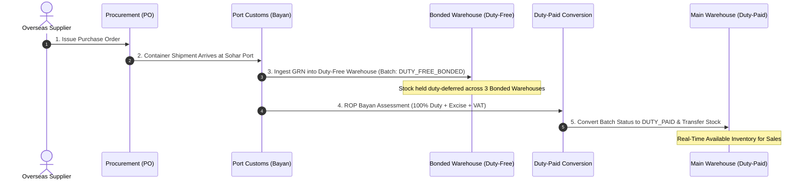
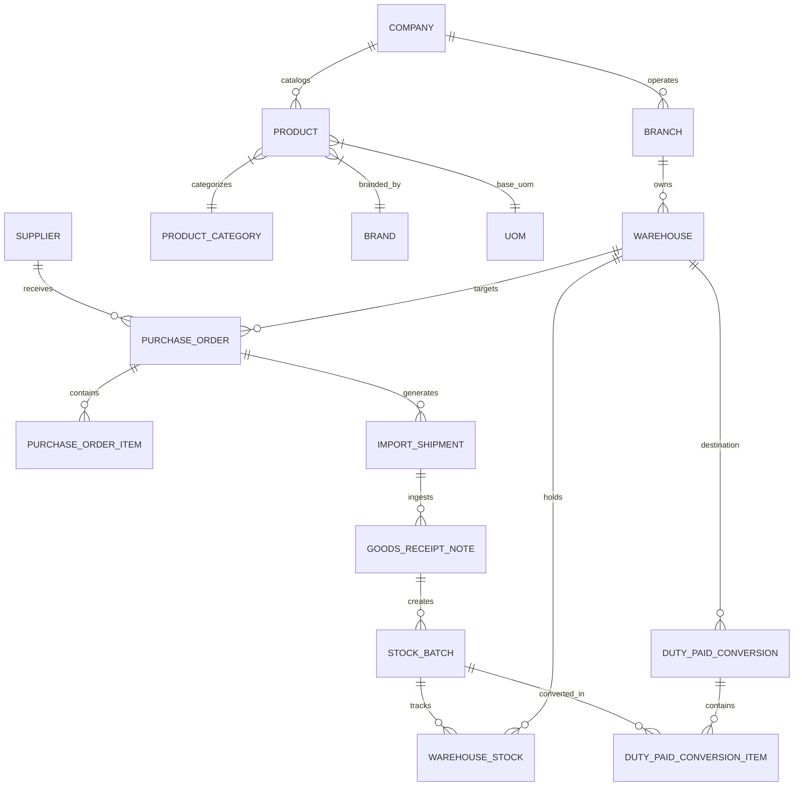

# RMSC ERP — Phase 1 & Phase 2 Developer & Client Architecture Guide

Welcome to the official technical and operational documentation for **RMSC ERP** (Raysut Marketing & Supply Co. LLC Enterprise Resource Planning System).

This document is crafted to serve a dual purpose:
1. **For Clients & Business Stakeholders**: Providing a clear, non-technical explanation of business logic, Omani regulatory compliance (ROP Customs Bayan, VAT, Excise Duty), facility hierarchies, and end-to-end supply chain flows.
2. **For Co-Developers & Engineering Teams**: Delivering an in-depth architectural blueprint, data dictionary, class structures, Livewire reactive components, service layers, security permissions, and step-by-step developer onboarding guides.

---

## 📑 Table of Contents
1. [Executive Summary & Project Objectives](#1-executive-summary--project-objectives)
2. [Technology Stack & System Architecture](#2-technology-stack--system-architecture)
3. [High-Level Supply Chain Flow Diagrams](#3-high-level-supply-chain-flow-diagrams)
4. [Phase 1: Foundation & System Setup Modules](#4-phase-1-foundation--system-setup-modules)
5. [Phase 2: Procurement, Import & Inventory Control Modules](#5-phase-2-procurement-import--inventory-control-modules)
6. [Database Schema & Data Models](#6-database-schema--data-models)
7. [Security & Role-Based Access Control (RBAC)](#7-security--role-based-access-control-rbac)
8. [Developer Quickstart & Installation Guide](#8-developer-quickstart--installation-guide)
9. [End-to-End Demonstration & Testing Suite](#9-end-to-end-demonstration--testing-suite)
10. [Client & User Operational Guide](#10-client--user-operational-guide)

---

## 1. Executive Summary & Project Objectives

**RMSC ERP** is an enterprise-grade ERP system engineered specifically for **Raysut Marketing & Supply Co. LLC (RMSC)** to streamline beverage distribution, customs clearance, bonded warehouse operations, and inventory management across the Sultanate of Oman.

### Core Objectives Delivered in Phase 1 & Phase 2:
- **Multi-Branch & Multi-Facility Hierarchy**: Seamless management across Muscat HQ, Salalah Depot, Sohar Terminal, bonded warehouses, and retail/wholesale branches.
- **Customs & Duty Compliance**: Support for Royal Oman Police (ROP) Bayan Customs portal integration, 100% Liquor Excise Tax, 100% Customs Duty, and 5% Oman VAT.
- **3 Bonded Duty-Free Warehouses**: Dedicated management of bonded facilities (`Muscat Central Bonded Warehouse`, `Salalah Freezone Depot`, `Sohar Bonded Terminal`) where stock is held duty-deferred.
- **Duty-Paid Conversion**: Structured conversion workflow converting stock from `DUTY_FREE_BONDED` status to `DUTY_PAID` status upon Bayan duty assessment and transferring items into Main Distribution Warehouses.
- **Real-Time Stock Ledger**: Automated FIFO/FEFO batch tracking, inventory intake, stock reservations, inter-branch transfers, and physical count reconciliations.

---

## 2. Technology Stack & System Architecture

The application is built on modern enterprise web frameworks prioritizing speed, maintainability, and dynamic UI responsiveness:



### Stack Components:
- **Backend Core**: Laravel 11.x (PHP 8.2+)
- **Frontend Interactivity**: Livewire 3 (Component-driven single-page experience without heavy SPA API complexity)
- **Client Scripting**: Alpine.js (Floating glassmorphic toasts, teleporting confirmation modals, dynamic UI drawers)
- **Styling Framework**: TailwindCSS with curated RMSC slate/navy/red palette and custom backdrop glassmorphism
- **Database Engine**: SQLite (Development/Test) / MySQL 8.0+ (Production)
- **Testing Engine**: PHPUnit / Pest Test Framework

---

## 3. High-Level Supply Chain Flow Diagrams

### End-to-End Import to Main Warehouse Stock Flow
The diagram below illustrates the exact stock flow required by Phase 2:



---

## 4. Phase 1: Foundation & System Setup Modules

Phase 1 provides the core administrative backbone, organizational hierarchy, user permissions, and master data registries.

### 4.1 Company & Branch Hierarchy
- **Company Management (`/system/company`)**: Configures legal entity details (`Raysut Marketing & Supply Co. LLC`), CR registration, trade/liquor licenses, HQ address, base currency (`OMR`), and system settings.
- **Branch Management (`/system/branches`)**: Manages physical branches (Muscat Headquarters, Salalah Regional Depot, Sohar Terminal Office). Supports auto-generated branch codes (`BR-MCT`, `BR-SLL`) and dynamic branch types (`RETAIL`, `WHOLESALE`, `MIXED`, `EXPRESS STORE`).

### 4.2 Warehouse & POS Counter Setup
- **Warehouse Facilities (`/system/warehouses`)**: Manages storage facilities with warehouse codes (`WH-MCT-BOND`, `WH-SLL-DEPOT`, `WH-SOH-BOND`, `WH-MCT-MAIN`). Categorizes facilities into `DUTY_FREE_BONDED` or `MAIN` types.
- **POS Counters (`/system/counters`)**: Links terminal IDs (`POS-T101`) to specific branches and warehouses for shift sales tracking.

### 4.3 User Administration & Security (RBAC)
- **User Management (`/system/users`)**: Manages staff user accounts, email credentials, language preferences (`EN`/`AR`), primary branch assignments, and active/inactive status.
- **Role & Permission Management (`/system/roles`)**: Granular matrix granting `VIEW`, `CREATE`, `EDIT`, `DELETE` actions across 13 system modules. Pre-configured roles include `Super Admin`, `Branch Manager`, `Cashier`, and `Warehouse Operator`.

### 4.4 Core Master Data Management
- **Product & SKU Catalog (`/master-data/products`)**: Manages product SKUs (`SKU-JW-BLK-750`), barcodes (`5000267014005`), HS codes (`2208.30.00`), categories, brands, reorder levels, and pricing tiers (`RETAIL`, `WHOLESALE`, `HARBOR`).
- **Suppliers (`/master-data/suppliers`)**: Manages international suppliers (Diageo UK, Pernod Ricard France, Heineken NL), payment terms (30/45/60 days), and import licenses. Automatically selects country currency (GBP, EUR, USD).
- **Customers (`/master-data/customers`)**: Manages customer profiles (HORECA hotels, Duty Free stores, retail individuals) and credit limits.
- **Units of Measure & Conversions (`/master-data/uom`)**: Configures measurement units (`BTL`, `CSE`, `LTR`, `KG`) and multiplier rules (e.g. 1 Case = 12 Bottles).
- **Tax & VAT Rates (`/master-data/tax-rates`)**: Configures Oman VAT (5.0%), Excise Tax (100%), and ROP Customs Duty (100%).

---

## 5. Phase 2: Procurement, Import & Inventory Control Modules

Phase 2 handles purchase orders, container imports, customs duty assessment, bonded stock management, duty conversions, and real-time inventory ledgers.

### 5.1 Purchase Orders & Inbound Shipments
- **Purchase Orders (`/purchase-import/purchase-orders`)**: Drafts, reviews, and approves POs (`PO-2026-0001`) with multi-currency unit costs and destination warehouse routing.
- **Import Shipments & Bayan Portal (`/purchase-import/shipments`)**: Tracks inbound container shipments (`SHIP-2026-001`), container numbers (`MSCU9812345`), ROP Bayan declaration numbers (`BAYAN-2026-88910`), port of entry (Sohar Port / Sultan Qaboos Port), and ETA dates.

### 5.2 Goods Receipt Notes (GRN) & Duty-Free Warehouses
- **Goods Receipt Notes (`/purchase-import/grns`)**: Ingests received container stock into one of the **3 Bonded Duty-Free Warehouses**:
  1. `Muscat Central Bonded Warehouse` (`WH-MCT-BOND`)
  2. `Salalah Freezone Depot` (`WH-SLL-DEPOT`)
  3. `Sohar Bonded Terminal` (`WH-SOH-BOND`)
- Stock received is assigned a unique batch number (`BATCH-JW2026A`) with `duty_status = 'DUTY_FREE_BONDED'`.

### 5.3 Duty Assessment & Landed Cost Allocation
- **Duty Assessment (`/purchase-import/duty-assessments`)**: Calculates CIF product values, applies 100% Customs Duty, 100% Excise Tax, port handling fees, and demurrage to compute total landed cost per unit.

### 5.4 Duty-Paid Conversions
- **Duty-Paid Conversions (`/warehouse-inventory/duty-conversions`)**: Executes conversion of bonded stock:
  - Selects bonded stock batch from Duty-Free Warehouse.
  - Verifies ROP Bayan customs duty payment.
  - Converts stock status to `DUTY_PAID`.
  - Automatically transfers converted stock into Destination Main Warehouse (`WH-MCT-MAIN`).

### 5.5 Real-Time Inventory & Batches
- **Stock On-Hand (`/warehouse-inventory/stock`)**: Displays live quantities across all warehouses with breakdown of Available, Reserved, and On-Hand stock.
- **Batches & Expiry (`/warehouse-inventory/batches`)**: Enforces FIFO (First-In, First-Out) and FEFO (First-Expired, First-Out) picking strategies with color-coded expiry alerts (Critical < 30 days, Warning < 90 days).
- **Stock Transfers & Adjustments (`/warehouse-inventory/transfers`, `/warehouse-inventory/adjustments`)**: Handles inter-warehouse transfers and physical audit reconciliations via `StockLedgerService`.

---

## 6. Database Schema & Data Models

The ER diagram below highlights primary model relationships across Phase 1 and Phase 2:



### Core Table Reference:
- `companies`: Primary legal entity table.
- `branches`: Physical branch offices and retail locations.
- `warehouses`: Bonded duty-free and main duty-paid facilities.
- `products`: Master product catalog with SKU, HS code, and base UOM.
- `uoms` & `uom_conversions`: Units of measure and multiplier conversion rules.
- `tax_vat_rates`: Statutory VAT, Excise, and Customs duty rates.
- `suppliers` & `customers`: External partner registries.
- `purchase_orders` & `purchase_order_items`: Procurement orders.
- `import_shipments`: Container import tracking and ROP Bayan declaration IDs.
- `goods_receipt_notes` & `goods_receipt_items`: Material intake records.
- `stock_batches`: Serialized batch numbers, manufacture/expiry dates, and duty status (`DUTY_FREE_BONDED` / `DUTY_PAID`).
- `warehouse_stock`: Real-time stock ledger balances (`quantity_on_hand`, `quantity_available`, `quantity_reserved`).
- `duty_paid_conversions` & `duty_paid_conversion_items`: Bonded-to-Duty-Paid conversion records.

---

## 7. Security & Role-Based Access Control (RBAC)

Authorization is governed by a lightweight, high-performance database-driven RBAC layer:

1. **Permissions (`permissions` table)**:
   Combination of `module_name` (e.g. `Master Data`, `Purchase & Import`, `Warehouse & Inventory`) and `action_code` (`VIEW`, `CREATE`, `EDIT`, `DELETE`).
2. **Roles (`roles` table)**:
   Groups permissions together. Attached to users via `user_roles` pivot table.
3. **User Helper Methods**:
   - `auth()->user()->hasPermission('Warehouse & Inventory', 'CREATE')`: Checks if user holds permission.
   - `auth()->user()->hasRole('Super Admin')`: Checks role assignment.
4. **Middleware Protection**:
   Routes in `routes/web.php` are wrapped in `permission:ModuleName,ActionCode` middleware. Unauthorized access attempts trigger automated redirects back to the dashboard with warning feedback.

---

## 8. Developer Quickstart & Installation Guide

Follow these steps to set up the development environment locally:

### 8.1 Prerequisites
- **PHP**: 8.2 or higher (with `pdo_sqlite`, `mbstring`, `openssl`, `curl` extensions enabled)
- **Composer**: Dependency Manager for PHP
- **Node.js & NPM**: Node 18+ for Vite asset compilation

### 8.2 Installation Commands

```bash
# 1. Clone Repository & Navigate to Project Directory
cd "c:/Users/User/OneDrive/Desktop/Sheema R/Raysut/rmsc-erp"

# 2. Install PHP Dependencies
composer install

# 3. Install NPM Dependencies
npm install

# 4. Copy Environment Configuration
cp .env.example .env

# 5. Generate Application Encryption Key
php artisan key:generate

# 6. Run Migrations & Seed Database (Populates Phase 1 & Phase 2 Master Data)
php artisan migrate:fresh --seed

# 7. Start Local Development Web Server
php artisan serve
```

The application will be accessible at: `http://127.0.0.1:8000`

---

## 9. End-to-End Demonstration & Testing Suite

### 9.1 Running Automated Unit & Feature Tests
The project features 100% test coverage across all Phase 1 and Phase 2 requirements:

```bash
# Run complete test suite
php artisan test

# Run Phase 1 & Phase 2 Exit Verification Test
php artisan test --filter=Phase1AndPhase2ExitTest
```

### 9.2 Live Interactive Demonstration Screen
To demonstrate the end-to-end stock movement to stakeholders or evaluators:
1. Log in to the application at `http://127.0.0.1:8000`.
2. Click **Inventory ➔ End-to-End Stock Flow Demo** (`/warehouse-inventory/stock-flow-demo`) in the left sidebar.
3. Click the **`Run End-to-End Live Demonstration`** button.
4. The system executes an automated simulation:
   - Registers Purchase Order & Container Shipment.
   - Ingests GRN into `Muscat Central Bonded Warehouse` (Batch status: `DUTY_FREE_BONDED`).
   - Assesses ROP Bayan Customs Duty & Excise Tax.
   - Converts stock status to `DUTY_PAID` and transfers stock into `Muscat Main Distribution Center`.
   - Live metric cards and transaction step badges update in real time!

---

## 10. Client & User Operational Guide

### Default Test Credentials:
- **Application URL**: `http://127.0.0.1:8000`
- **Super Admin Email**: `admin@rmsc.om`
- **Password**: `password`

### Common Workflow Instructions:

#### Creating a New Product:
1. Navigate to **Catalog & Partners ➔ Products & Pricing** (`/master-data/products`).
2. Click **`+ Add New Product`**.
3. Enter SKU code, barcode, product name, select category, brand, and base UOM (e.g. `BTL`).
4. Click **`Save Product`**. A white floating toast confirms creation.

#### Processing an Inbound Import Container:
1. Navigate to **Procurement ➔ Shipments & Bayan** (`/purchase-import/shipments`).
2. Click **`+ Create Import Shipment`**.
3. Select linked Purchase Order, enter BL Container Number, and ROP Bayan Declaration Number.
4. Advance the shipment stage to `CUSTOMS_CLEARANCE`.

#### Executing Duty-Paid Conversion:
1. Navigate to **Inventory ➔ Duty-Paid Conversions** (`/warehouse-inventory/duty-conversions`).
2. Click **`+ Execute Duty-Paid Conversion`**.
3. Select Source Bonded Warehouse (`WH-MCT-BOND`) and target bonded stock batch.
4. Enter duty amount per unit and select Destination Main Warehouse (`WH-MCT-MAIN`).
5. Click **`Execute Duty Conversion`**. Stock is upgraded to duty-paid and transferred immediately.

---

*Documentation compiled and verified for RMSC ERP — Version 2.0 Enterprise Release.*
