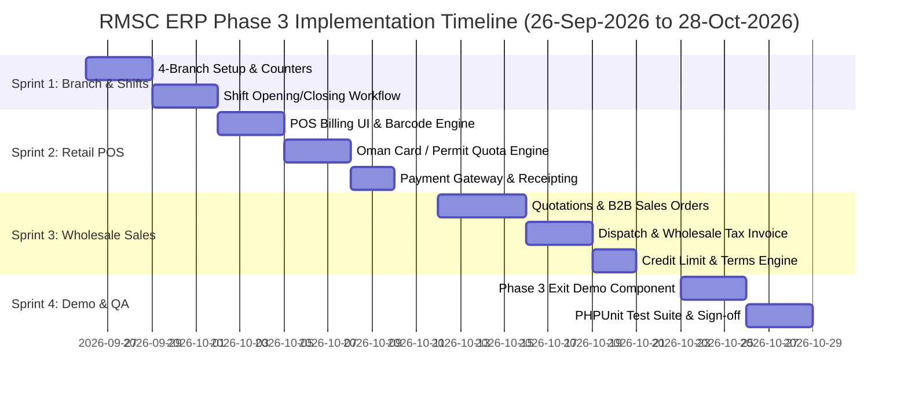
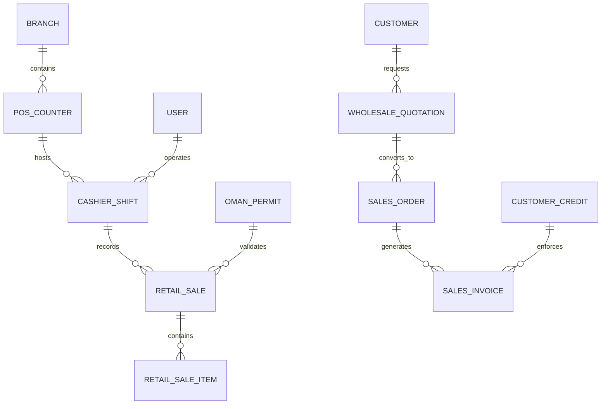

# RMSC ERP — Phase 3 Detailed Implementation Plan

**Project**: Raysut Marketing & Supply Co. LLC (RMSC) ERP  
**Phase**: Phase 3 — Branch Management, Retail & Wholesale Sales  
**Timeline**: 26-Sep-2026 (Sat) to 28-Oct-2026 (Wed)  
**Total Duration**: 23 Working Days (W/D)  
**Exit Milestone**: *Branch billing & wholesale workflow demonstrated*  

---

## 🎯 Executive Summary & Objectives

Phase 3 transitions RMSC ERP from system setup (Phase 1) and procurement/bonded warehouse management (Phase 2) into **commercial sales execution, branch billing, and wholesale distribution**.

### Primary Business Objectives:
1. **4-Branch Network Expansion**: Operationalize 4 distinct regional branches across Oman (Muscat HQ, Salalah Depot, Sohar Terminal, and Nizwa Regional Distribution).
2. **POS Counter & Shift Operations**: Implement cashier shift opening/closing workflows with opening cash floats, payment reconciliation (Cash vs Card), and cash variance tracking.
3. **Retail POS Billing with Oman Card Limit Check**:
   - High-performance retail point-of-sale (POS) checkout interface with barcode scanning.
   - **Oman Card / Personal Permit Verification Engine**: Mandatory validation of Civil ID (CIV) numbers, annual/monthly liquor allowance limits, remaining balance, and quota block enforcing Royal Oman Police permit compliance.
4. **Wholesale Quotation-to-Invoice Cycle**:
   - End-to-end B2B sales pipeline: `Wholesale Quotation ➔ Customer Approval ➔ Sales Order ➔ Goods Dispatch / Delivery Note ➔ Wholesale Tax Invoice`.
   - Real-time **Customer Credit Limit & Terms Enforcement** (blocking sales if customer exceeds credit limit or has overdue invoices > 30/60 days).
5. **Real-time Inventory Integration**: Instant inventory ledger updates (`quantity_on_hand` and `quantity_available` deduction) upon retail checkout or wholesale invoice issuance.

---

## 🗓️ 23-Working-Day Implementation Roadmap (Sprint Breakdown)

---

## 🏗️ Detailed Sprint Schedule & Work Breakdown Structure (WBS)

### 🔹 Sprint 3.1: 4-Branch Setup, POS Counters & Shift Operations (Days 1 – 5)
**Goal**: Complete facility topology and cashier shift control modules.

- **Task 3.1.1: 4-Branch & Counter Topology**:
  - Seed and configure 4 active branches:
    1. `BR-MCT`: Muscat Headquarters & Distribution
    2. `BR-SLL`: Salalah Regional Depot
    3. `BR-SOH`: Sohar Terminal Office
    4. `BR-NZW`: Nizwa Regional Distribution (`WH-NZW-MAIN` Nizwa Main Warehouse)
  - Configure POS Counters per branch (`CNT-MCT-01`, `CNT-SLL-01`, `CNT-SOH-01`, `CNT-NZW-01`).
- **Task 3.1.2: Shift Management Component (`App\Livewire\BranchOperations\ShiftManagement`)**:
  - **Shift Opening**: Cashier opens shift, inputs starting cash float (e.g. `OMR 50.000`), selects assigned counter.
  - **Active Shift State**: Tracks live sales totals during shift.
  - **Shift Closing**: Cashier inputs closing cash count, card payment totals, system calculates expected vs counted cash, records variance (`OMR +0.000` / `-2.500`), and locks shift.
- **Deliverables**: `/system/branches`, `/system/counters`, `/branch-operations/shifts`.

---

### 🔹 Sprint 3.2: Retail POS Billing & Oman Card Limit Engine (Days 6 – 12)
**Goal**: Build retail checkout terminal with mandatory Omani CIV personal permit quota verification.

- **Task 3.2.1: Retail POS Checkout UI (`App\Livewire\RetailSales\RetailPosBilling`)**:
  - Touch-friendly, fast POS grid with product search, category filter, and barcode scanner input listener.
  - Dynamic shopping cart with quantity adjust, line item discounts, and VAT (5%) breakdown.
- **Task 3.2.2: Oman Card / Personal Permit Verification Engine (`App\Services\OmanPermitService`)**:
  - Validates Civil ID / Oman Card Number (`CIV-78192039`) against personal permit database.
  - Checks annual purchase allowance (e.g. `OMR 500.000` per month/year) and historical purchases.
  - **Enforcement Rule**: If cart total exceeds remaining permit quota, system flags warning badge and **blocks checkout completion**.
- **Task 3.2.3: Multi-Payment Processing & Inventory Deductions**:
  - Supports Cash, Debit/Credit Card, and Split Payment.
  - On checkout completion:
    - Generates tax receipt `#` (e.g. `REC-2026-0089`).
    - Uses `StockLedgerService` to deduct stock from branch counter warehouse.
    - Updates cashier shift cash/card totals.
    - Updates Oman Card used quota allowance.
- **Deliverables**: `/retail-sales/pos`, `/retail-sales/receipts`, `OmanPermitService`.

---

### 🔹 Sprint 3.3: Wholesale Quotation-to-Invoice Cycle (Days 13 – 18)
**Goal**: Build B2B wholesale sales pipeline with credit limit & terms checks.

- **Task 3.3.1: Wholesale Quotations (`App\Livewire\WholesaleSales\QuotationManagement`)**:
  - Create B2B quotations (`QT-2026-0012`) for HORECA/Wholesale customers (Grand Hyatt Muscat, Oman Duty Free).
  - Select items, pricing tiers (`WHOLESALE`, `HARBOR`), validity dates, and payment terms (30/60 days).
  - Statuses: `DRAFT`, `SENT`, `APPROVED`, `CONVERTED`.
- **Task 3.3.2: Sales Orders & Goods Dispatch (`App\Livewire\WholesaleSales\SalesOrderManagement`)**:
  - Convert approved quotation into Sales Order (`SO-2026-0045`).
  - Reserve warehouse stock via `StockLedgerService::reserveStock()`.
  - Issue Delivery Note / Dispatch Note for warehouse picking.
- **Task 3.3.3: Wholesale Tax Invoices & Credit Limit Engine (`App\Livewire\WholesaleSales\WholesaleInvoiceManagement`)**:
  - Generate Official Wholesale Tax Invoice (`INV-2026-0102`) with 5% VAT.
  - **Credit Limit Verification**: Checks customer `credit_limit` vs `outstanding_balance`.
  - **Enforcement Rule**: If invoice total + current balance > credit limit, blocks invoice issuance requiring Manager Override approval.
  - Releases stock reservation and deducts stock from Main Warehouse (`WH-MCT-MAIN`).
- **Deliverables**: `/wholesale-sales/quotations`, `/wholesale-sales/orders`, `/wholesale-sales/invoices`.

---

### 🔹 Sprint 3.4: Phase 3 Exit Demonstration Component & Automated QA (Days 19 – 23)
**Goal**: Build 1-click demonstration visualizer and pass 100% PHPUnit feature tests.

- **Task 3.4.1: Interactive Exit Demonstration (`App\Livewire\BranchOperations\Phase3Demo`)**:
  - Visual dashboard demonstrating Phase 3 exit milestone:
    **`4 Branches ➔ Active Cashier Shift ➔ Retail POS (Oman Card Quota Check) ➔ Wholesale Quotation-to-Invoice Cycle`**
  - Includes **"Run Phase 3 End-to-End Live Demonstration"** button that executes full retail and wholesale sales simulation in 1 click.
- **Task 3.4.2: Automated Test Suite (`tests/Feature/Phase3ExitTest.php`)**:
  - Unit and feature test suite testing:
    - 4-branch and POS counter setup.
    - Shift opening, cash variance calculation, and shift closing.
    - Retail POS billing with Oman Card limit enforcement (verifying checkout block on quota exceed).
    - Wholesale quotation ➔ sales order ➔ delivery note ➔ tax invoice pipeline.
    - Customer credit limit blocking logic.

---

## 🗄️ Database Schema Extensions for Phase 3

The following database tables will be created in Phase 3 migrations:

### Table Specifications:
1. `cashier_shifts`:
   - `shift_id`, `counter_id`, `user_id`, `opened_at`, `closed_at`, `opening_float`, `closing_cash_counted`, `card_total`, `cash_variance`, `status` (`OPEN`, `CLOSED`).
2. `oman_permits`:
   - `permit_id`, `civ_number`, `holder_name`, `annual_allowance_omr`, `used_allowance_omr`, `expiry_date`, `is_active`.
3. `retail_sales` & `retail_sale_items`:
   - `sale_id`, `receipt_number`, `shift_id`, `customer_id`, `civ_number`, `subtotal`, `vat_amount`, `discount_amount`, `total_amount`, `payment_method`.
4. `wholesale_quotations` & `wholesale_quotation_items`:
   - `quotation_id`, `quotation_number`, `customer_id`, `branch_id`, `valid_until`, `total_amount`, `status`.
5. `sales_orders` & `sales_order_items`:
   - `order_id`, `order_number`, `quotation_id`, `customer_id`, `warehouse_id`, `status`.
6. `sales_invoices` & `sales_invoice_items`:
   - `invoice_id`, `invoice_number`, `order_id`, `customer_id`, `subtotal`, `vat_amount`, `total_amount`, `payment_terms_days`, `payment_status`.

---

## 📋 Exit Milestone & Acceptance Criteria Checklist

| Requirement | Verification Criteria | Target Date |
| :--- | :--- | :---: |
| **4-Branch Network** | 4 active branches (`BR-MCT`, `BR-SLL`, `BR-SOH`, `BR-NZW`) with mapped warehouses and POS counters. | 28-Sep-2026 |
| **Shift Management** | Cashier shift opening, float input, closing cash count, variance logging, and shift lock. | 01-Oct-2026 |
| **Retail POS Terminal** | Barcode scan, quick add/remove, discount calculation, VAT 5%, and receipt printing. | 05-Oct-2026 |
| **Oman Card Quota Check** | CIV card permit validation; system blocks checkout if purchase exceeds annual/monthly allowance. | 08-Oct-2026 |
| **Quotation-to-Invoice** | Complete B2B sales cycle: `Quotation ➔ Sales Order ➔ Dispatch ➔ Tax Invoice`. | 16-Oct-2026 |
| **Customer Credit Limit** | B2B invoice generation blocks transaction if customer exceeds credit limit or overdue terms. | 18-Oct-2026 |
| **Real-Time Stock Intake** | Inventory deducted automatically from counter/warehouse stock upon sale/invoice posting. | 20-Oct-2026 |
| **Interactive Demo** | 1-Click Phase 3 Demonstration visualizer available at `/branch-operations/phase3-demo`. | 24-Oct-2026 |
| **Test Suite Sign-off** | 100% PHPUnit feature test pass on `Phase3ExitTest.php`. | 28-Oct-2026 |

---

*Phase 3 Implementation Plan approved for execution — Raysut Marketing & Supply Co. LLC.*
